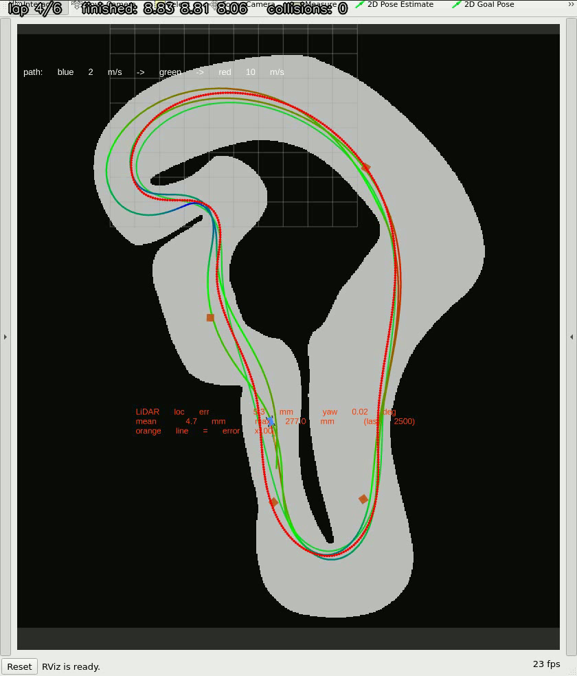

# GT 없이 달리는 장애물 회피 MPC (LiDAR 위치 추정 + CorridorMPC)

ForzaETH F1TENTH 시뮬레이터(ROS 2 Humble)에서 **LiDAR 스캔과 지도만으로** 자기 위치를 추정하면서,
랩마다 무작위로 놓이는 정지 장애물을 피해 달리는 주행기다.
시뮬레이터의 정답 위치(`/car_state/pose_GT`, `/car_state/odom_GT`)는 시작할 때 한 번 받는 초기 자세 말고는 쓰지 않는다.

```
/scan ──► LidarLocDriver (위치 추정) ──x, y, yaw, v, r──► CorridorMPC (장애물 인식 → DP → 통로 → LTV-MPC → 속도) ──► /drive
             ▲                                                      │
             └──────────── 실제로 보낸 명령 (조향각, 속도) ◄────────┘
```



빨간 선은 맵 레이싱라인, 초록 선은 주행기의 레이싱라인, 색 있는 선은 실제로 달린 경로다(파랑 2 m/s → 빨강 10 m/s).
주황색 박스는 장애물이고, 글자는 LiDAR 위치 오차(정답과 비교, 표시용)다.

## 결과 (berlin 맵, 기본 시뮬레이터 파라미터)

**현재판(2026-11-24, 후진 없음 + 스캔 잡음 적응)의 시험 형식 결과는 [6장](#6-2026-11-24-변경-시험-규칙-대응)에 있다.** 아래 표들은 그 전 버전들의 기록이다.

### 2026-11-19 개정판 vs 이전판 (LiDAR, GT 없음)

바뀐 점은 [6장](#6-2026-11-19-변경)에 정리했다. 아래는 개발에 쓰지 않은 시드에서 이전판과 짝지어 비교한 결과다.
- 하네스는 ROS와 비슷한 타이밍으로 돌렸다.
- 에뮬레이터는 ROS 브리지 타이밍을 흉내 낸다(실시간 0.9배, 스텝 흔들림, 지연).
- 한 에피소드는 3랩이다.

| 시드 / 조건 | 충돌 | 멈춤 | 평균 랩 |
|---|---|---|---|
| 1000-1099, 하네스, 장애물 4개 | 1 → 1 | 5 → 1 | 8.71 → 8.62 s |
| 1000-1099, 하네스, 장애물 5개 | 0 → 0 | 4 → 1 | 짝지은 차이 -0.05 s |
| 1100-1199, 하네스, 장애물 4개 | 0 → 0 | 1 → 0 | 8.76 → 8.51 s |
| 1100-1199, 하네스, 장애물 5개 | 7 → 6 | 1 → 2 † | 8.94 → 8.60 s |
| 1100-1199, 에뮬레이터, 장애물 4개 / 5개 | 1 → 0 / 4 → 2 | 1 → 0 / 1 → 1 | 짝지은 차이 -0.20 / -0.28 s |
| 1300-1399, 하네스, 장애물 4개 / 5개 | 0 → 0 / 0 → 0 | 3 → 0 / 3 → 0 | 9.02 → 8.60 / 8.84 → 8.71 s |
| 1300-1349, 에뮬레이터, 장애물 4개 / 5개 | 0 → 0 / 0 → 0 | 0 → 0 / 0 → 0 | 8.80 → 8.50 / 9.25 → 8.56 s |
| 장애물 없음 (시드 0-7, 1100-1107, 1300-1307, 10랩) | 0 → 0 | 0 → 0 | 플라잉 랩 7.258 → 7.257 s (거의 비트 단위로 같음) |

- 베스트 랩은 한 조건(1300-1399 장애물 4개: 7.60 → 7.62 s)을 빼면 같다. 평균 랩이 좋아진 건 대부분, 이전판이 헤어핀 시케인에서 20-48초씩 후진하던 랩(100에피소드당 4-6개)이 11-20초로 줄었기 때문이다. 랩 중앙값은 그대로다.
- † 하네스가 충돌 뒤 차를 박스와 겹치게 다시 놓은 경우다(차체가 박스 안으로 5-7 cm). 이전판은 그 상태로 기어가다 충돌로 세어졌고, 개정판은 갈 수 있는 원호가 없어서 멈췄다. 실제 레이스에서는 운영자가 차를 다시 놓으니 해당하지 않는다.
- 남은 충돌은 고속에서 난 것이고, 이전판과 같은 레이아웃에서 똑같이 난다.

ROS 실시뮬, 개정판(장애물 4개, 시드 7, 다른 작업 없음):
- 42랩, 충돌 0, 멈춤 0. 평균 8.71 s, 베스트 7.92 s.
- 이전판이 헤어핀 시케인에서 서버렸던 배치(시드 7의 네 번째 랩 배치)는 8.49 s에 그냥 지나갔다. 다만 이전판이 멈췄던 그 실행은 다른 학습 작업과 CPU를 나눠 쓰던 중이었다.
- 가장 느린 랩은 13.53 s다(원호 기동이 들어간 랩).
- `act()` 평균 3.7 ms(p99 6.9 ms). 원호 탐색 중에는 호출 간격이 최대 340 ms까지 벌어진다(차가 서 있을 때).

### 이전판의 검증 결과

오프라인(f1tenth_gym + race_manager 장애물 배치, 3랩/에피소드). 주행기마다 장애물 있는 랩 900개다.
"GT"는 같은 MPC에 시뮬레이터 정답 상태를 준 것이다.

| 조건 | GT: 충돌 / 멈춤 / 평균 랩 | LiDAR(GT 없음): 충돌 / 멈춤 / 평균 랩 | LiDAR 위치 오차 최대 |
|---|---|---|---|
| 장애물 없음 | 0 / 0 / 7.25 s | 0 / 0 / 7.26 s | 8.0 mm |
| 장애물 4개, 시드 0-99 | 1 / 2 / 8.53 s | 1 / 1 / 8.45 s | 12.0 mm |
| 장애물 5개, 시드 0-99 | 0 / 0 / 8.66 s | 0 / 1 / 8.61 s | 11.0 mm |
| 장애물 4개, 처음 보는 시드 900-999 | 2 / 3 / 8.56 s | 1 / 3 / 8.70 s | 12.0 mm |
| ROS 타이밍 흉내(실시간 0.9배, 스텝 흔들림, 지연) 전체 | 충돌 9 | 충돌 4 | ≤ 12.3 mm |

ROS 실시뮬, 이전판(장애물 4개, 시드 7):

| 실행 | 랩 | 충돌 | 랩타임 |
|---|---|---|---|
| CPU 여유 있음 | 42 | 0 | 평균 8.74 s, 베스트 8.06 s |
| 처음 19랩은 다른 학습 작업과 CPU를 나눠 씀 | 23 | 0 | 나눠 쓸 때 9.5-11.7 s, 학습을 멈춘 뒤 7.87-8.52 s. 헤어핀 시케인에서 1번 멈춤(손으로 다시 놓음) |

- 주행기 한 번 계산 시간(`act()`)은 평균 약 4 ms다(Ryzen 7, 다른 작업 없음). 위치 추정 몫은 0.5-1 ms다.
- 채점기는 벽시계 시간으로 랩을 잰다. CPU가 부족하면 시뮬레이터가 실제 시간보다 느리게 돌아서 랩타임이 늘어난다.

## 1. 위치 추정: `drivers/lidar_loc.py` (`LidarLocDriver`)

다른 주행기를 감싸는 wrapper다. `act(scan, x, y, yaw, v, yaw_rate, t)` 형태의 주행기라면 무엇이든 안에 넣을 수 있다.
안쪽 주행기에는 시뮬레이터 정답 대신 자기가 추정한 상태를 넘긴다.

**쓰는 정보**
- LiDAR 스캔: 1080개 빔, 시야 4.7 rad, 차 기준점보다 0.27 m 앞에 달려 있다.
- 점유 지도: `stack_master/maps/<map>`의 이미지와 임계값. 시뮬레이터가 레이캐스트하는 그 지도다.
- 자기가 보낸 명령(조향각, 속도)과 차량 모델.
- 초기 자세 1개: `/initialpose`(운영자가 차를 놓은 자세), 맵 시작점(`init="start"`), 또는 전역 탐색(`init="global"`).

**한 번의 계산(`act()`)마다 하는 일**

1. **시계:** 실제 ROS 브리지는 물리 스텝을 흔들리는 벽시계 타이머로 돌린다. 그래서 두 스캔 사이에 10 ms 스텝이 1-3개 들어간다.
   스텝 수는 스캔이 직접 판단한다: 가능한 스텝 수마다 예측하고 정합해서 가장 잘 맞는 것을 고른다. 필터, 명령 이력, 지연 추정, 안쪽 주행기는 모두 이 시뮬레이터 시계로 돈다.
2. **예측:** EKF 상태는 `s = [x, y, yaw, v, r, beta]`다.
   - 보낸 명령을 시뮬레이터와 같은 모델로 10 ms씩 적분한다(RK4). 모델에는 2스텝 조향 버퍼, 조향 서보 3.2 rad/s, 속도 P제어기, `sim_params.yaml`의 single-track 모델이 들어간다.
   - 0.5 m/s 미만이나 후진에서는 시뮬레이터처럼 기구학 모델로 바꾼다.
3. **측정 갱신:** 스캔을 지도에 맞추는 정합을 iterated EKF로 한다(사전 분포 + robust 스캔 비용의 Gauss-Newton).
   - 빔 끝점을 지도의 부호 있는 거리장(SDF)에 bilinear로 맞춘다.
   - Huber 가중치를 쓰고, 첫 반복은 0.25 m, 이후는 약 5σ에서 자른다. 그래서 장애물이나 지도에 없는 물체는 무시된다.
   - 빔 오차는 지도 픽셀을 통해 서로 상관돼 있어서, 스캔 정보량을 줄여서(`info_scale`) 쓴다.
4. **지연 다중 모델:** 명령 지연 0-150 ms 가설마다 EKF를 하나씩 둔다. 스캔 근거(Laplace 근사)를 망각 계수와 함께 누적해서 가장 그럴듯한 가설을 고른다(히스테리시스).
   이 지연 추정값은 안쪽 MPC에도 넘긴다.
5. **품질과 재위치 추정:** 매 스캔마다 inlier 비율을 본다.
   - free-space 끝점이 1 m(`obs_ext`)보다 짧게 뭉쳐 있으면 장애물로 보고 세지 않는다. 자세가 틀리면 벽 끝점이 몇 m씩 길게 어긋나기 때문이다.
   - 이전에는 이 값이 race_manager 장애물 크기에서 가져온 0.55 m였다. 그래서 0.45 m 장애물에서는 위치를 잃었다.
   - 나쁜 스캔이 이어지면 예측 주변을 correlative search로 다시 찾고, 그래도 안 되면 지도 전체를 탐색한다(약 0.3 s).

`forbid_gt=True`이면 GT를 읽으려는 순간 예외가 난다. 그리고 `avoid_node.py`는 GT 토픽을 아예 구독하지 않는다.
이 경우 노드가 구독하는 것은 `/scan`과 `/initialpose`뿐이다(`ros2 node info /avoid_driver`로 확인).
초기 자세 뒤로는 GT 인자에 NaN이나 난수를 넣어도 명령이 비트 단위로 같다는 것을 시험으로 확인했다.

## 2. 주행기: `drivers/cmpc_berlin_tt.py` + `drivers/cmpc_berlin_obs.py` (`CorridorMPC`)

클래스는 `cmpc_berlin_tt.py`에 하나만 있다. 장애물 기동은 kwarg로 켜고 끈다. 끄면 시간 기록용(`berlin_tt.json`)이 되고, 켜면 장애물용(`berlin_obs.json`)이 된다.
`cmpc_berlin_obs.py`는 예전 import 경로(`drivers.cmpc_berlin_obs:CorridorMPC`)를 유지하려고 남긴 몇 줄짜리 파일이다.

### 2.1 상태 추정과 지연 보상
- 조향 서보와 속도 P제어기를 자기가 보낸 명령으로 시뮬레이션해서, 지금 실제 조향각과 가속도를 안다.
- CG 횡미끄럼각(측정 안 됨)은 측정 요레이트로 굴린 single-track 모델과 연속 위치의 진행각으로 추정한다.
- 상태를 새 조향 명령이 실제로 먹히는 시점까지 비선형 모델로 예측한다.
- **온라인 추정:**
  - 명령 지연: 0-150 ms 후보, 다중 모델.
  - 타이어 강성 배율 `c`: 강성 × 추가 지연 격자의 병렬 single-track 모델을 측정 요레이트와 비교해서 고른다.
  - 측정 잡음: 적응형 Kalman 이득.
  - 호출 주기.
  - 이렇게 추정한 값으로 모델 전체를 맞춘다. 마찰이나 타이어가 20% 약해져도 벽에 안 박게 하려는 것이다.

### 2.2 장애물 인식
- 스캔 끝점을 지도 좌표로 옮긴다. 지도 벽에서 `obs_edt`(9 cm)보다 먼 점은 장애물 셀이다(지도 거리변환 사용).
- 장애물 셀은 랩 단위로 기억한다. race_manager가 랩마다 배치를 바꾸기 때문이다.
- 빔이 지나간 셀은 비어 있는 것으로 지운다(carving).
- 셀을 묶어서 Frenet 좌표의 박스로 만든다. 박스는 측정된 셀 범위 그대로다. 패딩은 s 6 cm, d 2 cm이고, s 길이는 최소 0.2 m(MPC 스테이션 간격)다.
- 안 보이는 뒷면과 가려진 옆면은 채우지 않는다. 못 본 경로점은 시야 속도 제한(`v_vis_safe`)으로 다룬다. 트랙의 다른 못 본 곳과 같은 방식이다.
- **장애물 크기 가정 없음:** 예전에는 `hidden_depth` 0.43 m, `w_max` 0.43 m, `min_width` 0.30 m(race_manager의 0.30 m 정육면체 값)로 박스를 키웠다. 지금은 지웠고, 넘기면 KeyError가 난다.
  - 비용: 0.30 m 정육면체 1800랩(하네스 시드 1400-1499·1720-1819 1200랩, ROS 타이밍 에뮬레이터 시드 1400-1449·1720-1769 600랩, 장애물 4개·5개)에서 충돌이 8번 났다. 예전 방식은 2번이었다. 랩타임은 같거나 조금 빨랐다(짝지은 랩 평균 -0.06 / -0.11 s, 중앙값 0 / -0.01 s).
  - 다른 크기와 모양 540랩(0.15 m·0.45 m 정육면체, 0.45 × 0.20 m 판자 두 방향, 0.60 × 0.15 m 벽 두 방향, 시드 1500-1559)에서는 충돌이 2번이었다(예전 4번). 랩타임은 같았다(짝지은 랩 평균 +0.004 s, 중앙값 0).
  - 0.30 m 충돌 4번 중 3번은 같은 식으로 났다. 멀리서 장애물 일부만 보이면 박스가 좁고 한쪽으로 치우쳐 잡힌다. 그래서 DP가 실제 장애물이 뻗어 있는 쪽으로 지나가기로 정한다. 가까이 가면서 박스가 실제 폭으로 넓어지는데, 정한 쪽을 지키느라 크게 꺾다가 벽이나 다음 장애물에 닿았다. 예전 `min_width` 0.30 m는 처음부터 박스를 넓게 잡아서 이런 경우를 막았다.
  - 다른 방식도 시험했다.
    - 빔이 아직 안 지나간 곳을 막아 두기: 랩당 0.14-1.4 s 느렸다.
    - 뒷면 깊이 = 보이는 폭(정사각형 가정): 충돌은 0번이었지만 랩당 평균 0.25 s 느렸다.
    - 박스가 넓어지는 중이면 지나갈 쪽 확정을 풀기: 개발 시드의 충돌 4번 중 3번은 없앴지만, 처음 쓰는 시드 900랩에서는 충돌 수가 같았다(4번 대 4번). 차에서 2.5 m 안쪽(확정 거리)에서야 박스가 넓어지는 경우는 막지 못해서 넣지 않았다.

- **스캔 잡음 적응(`noise_adapt`, 위치 추정 wrapper에서 기본으로 켜짐):** 위치 추정기는 매 스캔 지도 대비 빔 잔차의 RMS(`rms_ema`)를 잰다. 이 값이 기준 잡음 `sig_b`(1.4 cm)보다 크면 비율 rho = rms_ema / sig_b를 쓴다.
  - 장애물 셀 문턱 `obs_edt`를 rho배로 키운다. 기준 잡음일 때와 같은 표준편차 배수가 된다.
  - 주행기에 넘기는 스캔에는 이웃 빔 n개의 중앙값 필터를 건다. n은 (π/2)·rho² 이하의 가장 큰 홀수이고 최대 9다. 위치 추정은 원래 스캔을 그대로 쓴다.
  - 기본 잡음에서는 명령이 비트 단위로 같다. 스캔 잡음 +3 cm에서는 유령 장애물이 낀 DP 호출이 98 %에서 4 %로 줄고, 10랩 무사고 비율이 0.673에서 0.873이 됐다(같은 코드에서 잡음 적응만 끈 것과 비교, 150판).

### 2.3 DP: 장애물마다 왼쪽/오른쪽 고르기
- Frenet 격자(0.5 m 간격, 횡방향 5 cm) 위에서 보이는 모든 장애물에 대해 한 번에 일관된 쪽을 고른다.
- 비용 항목:
  - 레이싱라인 이탈
  - 기울기와 곡률 변화
  - 차가 꺾을 수 있는 기하 곡률 한계(`dp_kgeo`)
  - 벽과 장애물 근접
- 한번 고른 쪽을 바꾸면 벌점을 준다(히스테리시스). 장애물에 가까울수록 거의 바꿀 수 없게 된다.
- 벽까지 틈이 좁은 쪽은 후보에서 뺀다(`min_gap_w`: 기본 6 cm, 장애물 모드 10 cm, 이미 고른 쪽은 3 cm 덜 엄격).
- 한쪽이 좁고 반대쪽이 확실히 넓으면 좁은 쪽을 닫는다(`g_narrow`, `g_diff`).
- 고른 쪽들로 차체 기준선의 정확한 통로 `lb(s) ≤ d ≤ ub(s)`가 정해진다. 장애물과 벽 경계는 충돌 박스 반폭과 여유만큼 이미 부풀려져 있다.

### 2.4 공간 LTV-MPC
- **모델:** 시뮬레이터와 같은 선형 타이어 single-track 모델을 Frenet 좌표로 쓴다.
  - 상태: `d`(횡오차), `mu`(라인 대비 헤딩), `beta`, `r`, `delta`
  - 입력: 조향 속도(|·| ≤ 3.2 rad/s)
- **이산화:** 시간이 아니라 거리 단위다. 0.2 m 간격 40 스테이션, 즉 8 m 앞까지 본다.
  계획 속도 프로파일을 따라 스테이션마다 정확히 이산화한다(행렬 지수). 계획 가속도에서 하중 이동도 반영한다.
- **제약:**
  - 충돌 박스의 세 점(CG, +0.22 m, +0.435 m)이 통로 안에 있어야 한다. soft 제약이고 벌점이 크다.
  - 횡가속도 |v r| ≤ `a_lat_hard`도 soft 제약이다.
- **솔버:** HPIPM(CasADi에 들어 있는 `libhpipm.so`를 ctypes로 호출)이다. QP 데이터는 numba 커널이 솔버 버퍼에 바로 쓴다.
  새 속도 프로파일이 가까운 미래의 가속도를 2 m/s² 넘게 바꾸면 한 번 더 푼다.

### 2.5 속도 프로파일
- MPC 경로 위에서 계산한다.
- 횡가속도 한계를 지킨다. 지연에 따라 적응하는데, 명령 지연이 60-70 ms로 커지면 14 → 12 m/s²로 줄인다.
- 계획 제동은 조향이 유지되는(요 안정) 감속도 안에서만 한다.
- **비상 envelope**는 두 가지다:
  - 막힌 통로 앞에서 설 수 있는 속도
  - 스캔이 아직 못 본 첫 경로점에 `v_vis_safe` 이하로 도달할 수 있는 속도
- 트랙 폭이 2.8 m보다 좁은 구간에서는, 시야 끝에 장애물이 나타나도 멈출 수 있게 미리 감속한다(`w_front`, `v_hz`).
- 두 장애물을 반대쪽으로 연달아 지나가는 S자(weave)는, 곡률 4·dd/l²(dd: 옆으로 옮겨야 할 거리, l: 두 박스 사이 측정 간격, 최소 MPC 스테이션 0.2 m)을 `a_weave`(6 m/s²)로 낼 수 있는 속도로 제한한다. 예전에는 l에 근거 기록 없는 0.3 m(장애물 크기와 같은 숫자)를 더했는데 지웠다. 시험 형식 390판에서 10랩 무사고 0.890 대 0.869, 접촉 14 대 12로 잡음 수준 차이였다.
- 속도는 MPC가 아니라 이 속도 프로파일이 정한다.
  - 경로가 정해지면 전진·후진 패스로 구한 이 프로파일은 같은 제약 아래에서 이미 최소 시간 해다. 기록된 계획 1,189개에서 차이는 최대 2e-14 m/s였다.
  - 속도를 MPC 상태로 옮겨도 위 제약들은 그대로 경계로 남고 QP 계산만 2-3배가 된다. 그래서 옮기지 않았다.
  - 랩타임을 가장 많이 잡는 것은 안전용 시야 제한(`v_vis_safe`)이다. 이걸 풀면 장애물 4개에서 랩당 0.8-0.9 s 빨라지지만 충돌이 1번에서 18번으로 는다.

### 2.6 저속 기동
1. **느린 DP:** DP가 길을 못 찾으면 `v_slow`(1.5 m/s)로 꺾을 수 있는 곡률로 다시 계획한다. 그리고 좁은 곳 앞에서 그 속도까지 줄인다.
2. **확인 검사:** 3 m/s 미만에서는 계획 경로 앞부분(max(0.2 m, 0.4 s × 속도))을 따라 차체 점들이 장애물(측정 셀)에서 4 cm, 벽에서 3 cm 떨어져야 한다. 아니면 정지한다.
3. **원호 탐색(전진만):** 1 s(`man_after`) 동안 서 있었는데 갈 길이 없으면, 전진 원호를 최대 3개까지 이어 붙인 기동을 찾는다.
   - 원호 후보: 조향 {-1, -0.5, 0, 0.5, 1}×최대각 × 길이 {0.35, 0.7, 1.2} m, 모두 15개다. 후진 원호는 코드에서 지웠다. 주행기는 음수 속도 명령을 내지 않는다.
   - 1·2개짜리 조합은 전부 보고, 그중 좋은 2개짜리 40개에 원호를 하나 더 붙여 본다.
   - 차체 점이 5 cm마다 벽에서 4 cm, 기억한 장애물 셀에서 6 cm 떨어져야 유효하다.
   - 점수 = 라인 방향 진행(2.5 m까지) - 길이 - 헤딩 오차 + 여유.
   - 실행: 원호마다 멈추고, 선 채로 바퀴를 돌린 다음, 0.45 m/s로 전진한다. 0.5 m/s 미만은 시뮬레이터의 기구학 영역이라 예측이 정확하다. 가는 동안 매 호출마다 남은 원호를 다시 검사하고, 막히면 멈춘다.
   - 마지막 원호가 끝나면 MPC가 이어받는다. MPC 계획이 0.2 s 동안 계속 주행 가능하면 일찍 넘긴다(`man_happy`).
   - 탐색은 서 있을 때 한 번 하고 60-120 ms 걸린다. 찾은 기동은 한 장소에서 최대 8번(`man_max`)까지만 한다. 못 찾으면 1 s 뒤 다시 찾는다.
   - MPC로 하지 않는 이유: Frenet MPC는 라인을 따라 주행 속도로 계획하고, 통로 제약은 세 점, 여유는 속도에 따라 커진다. 박스 옆에 선 차(헤딩이 크게 틀어졌을 수도 있다)에는 차체 전체를 측정 장애물 점과 맞춰 보는 짧은 저속 경로가 필요한데, 그 통로로는 나타낼 수 없다. 원호 탐색은 차가 서 있고 주행 가능한 계획이 없을 때만 돈다. 같은 DP·MPC를 저속 설정으로 다시 푸는 방식도 시험했지만, 10랩 무사고 비율이 0.881 대 0.945로 낮았다.
   - 예전 kwarg `back_dist`, `back_after`, `back_max`, `man_v`는 지웠다(넘기면 KeyError). 지금 이름은 `arc_search`, `man_after`, `man_max`다.
4. **헤딩 가드:** 라인 대비 헤딩이 1.6 rad를 넘으면 선다. Frenet 선형화가 깨지기 때문이다. 그다음 원호 탐색이 차를 편다(전진으로).
5. **저속 비상(`soft_em`):** 1.5 m/s 이하에서 계획이 통로를 8 cm 이내로만 벗어나면 비상 정지 대신 1 m/s로 계속 간다. 빼 보니 멈춤과 충돌이 늘어서 남겨뒀다.

### 2.7 레이싱라인과 장애물 모드
- `maps_ext/berlin/tt/mtr_def_0.2.json`은 최소 시간 레이싱라인이다(46.6 m, 맵 기본 라인은 48.8 m).
  주행기 안에서만 맵 라인을 대신한다. s = 0은 맵 라인의 결승선에 다시 맞춘다.
- 장애물 모드(`obs_kw`)는 첫 랩, 박스를 본 다음 랩, 그리고 그 랩의 첫 박스부터 켜진다. 비어 있는 트랙은 시간 기록용 파라미터로 달린다.

### 2.8 주요 설정 (`profiles/berlin_obs.json`)

| 파라미터 | 값 | 뜻 |
|---|---|---|
| `a_lat`, `a_lat_hard` | 14 m/s² | 횡가속도 한계(계획 / soft 제약) |
| `lat_alat` | [0.06, 0.07, 12] | 명령 지연이 60 → 70 ms일 때 a_lat 14 → 12 |
| `a_acc`, `jerk`, `v_max` | 7.5 m/s², 120 m/s³, 11 m/s | 가속, 저크, 최고속도 |
| `obs_kw.v_vis_safe` | 2.0 m/s | 못 본 경로점 도달 속도 |
| `w_front`, `v_hz` | 2.8 m, 0.5 m/s | 좁은 구간 시야 끝 정지 준비 |
| `v_slow` | 1.5 m/s | 느린 DP 속도 |
| `creep_chk`, `prox_v` | 0.2 m, 3 m/s | 저속 확인 검사 |
| `arc_search`, `man_after`, `man_max` | true, 1 s, 8 | 전진 원호 탐색 켜기, 서 있는 시간, 장소당 최대 기동 수 |
| `man_lens`, `man_m_wall`, `man_m_obs`, `man_happy` | (0.35, 0.7, 1.2) m, 4 cm, 6 cm, 0.2 s | 원호 길이, 벽/장애물 여유, 이른 반납 (기본값) |
| `mu_max` | 1.6 rad | 헤딩 가드 |
| `fg_check` | false | 명령 추종 검사 끔(오프라인 경보가 전부 오경보였음) |

위치 추정 wrapper의 `noise_adapt`(기본 true)와 `med_max`(9)는 프로필이 아니라 wrapper kwarg다.

`profiles/berlin_tt.json`(FAST)과 `berlin_tt_safe.json`(a_lat 12)은 장애물 없는 시간 기록용이다. 둘 다 장애물 인식은 켜져 있다.

## 3. 설치와 세팅

### 3.1 필요한 것
- Ubuntu 22.04와 ROS 2 Humble
- ForzaETH race stack의 ROS 2 시뮬레이터를 `~/forza_ws/race_stack`에 빌드해둔 상태(`colcon build`)
  - 주행기는 지도를 `~/forza_ws/race_stack/stack_master/maps/<map>/`에서 읽는다(`<map>.yaml`, `.png`, `global_waypoints.json`). 이 경로는 코드에 박혀 있다(`drivers/*.py`의 `MAPS` / `MAPDIR`). 다른 곳에 있으면 심볼릭 링크를 만든다.
  - 무작위 장애물과 랩 채점은 `race_manager` 패키지가 한다. 이 패키지는 수업용 race stack에 들어 있고 공개돼 있지 않다. 없으면 `run_avoid.sh`가 장애물 없이 돌린다.
- 시뮬레이터 차량 파라미터는 기본값(`sim_params.yaml`)이다. MPC의 모델 상수(`drivers/cmpc_berlin_tt.py` 상단)가 이 값과 같아야 한다.

### 3.2 설치
```bash
git clone https://github.com/delboy11/forza-lidar-corridor-mpc.git
cd forza-lidar-corridor-mpc
pip install --user -r requirements.txt
chmod +x run_avoid.sh
```
첫 실행 때는 numba 커널을 컴파일하느라 1-2분 걸린다. 결과는 `drivers/__pycache__`에 캐시되고, 그다음부터는 몇 초면 뜬다.

### 3.3 실행
GT 없는 장애물 MPC(LiDAR 위치 추정 + `cmpc_berlin_obs`), 장애물 4개, 시드 7, berlin 맵:
```bash
./run_avoid.sh drivers.lidar_loc:LidarLocDriver \
  '{"init": "start", "forbid_gt": true, "inner": "drivers.cmpc_berlin_obs:CorridorMPC", "profile": "profiles/berlin_obs.json"}' \
  4 7 berlin
```
- 인자 순서: `<module:Class> '<json kwargs>' [장애물 수] [시드(-1이면 무작위)] [맵]`
- 순서대로 시뮬레이터, race_manager, 시작 자세(`/initialpose`), 주행 노드(`avoid_node.py`, 50 Hz)를 띄운다. 종료는 Ctrl-C다.
- 로그는 `~/race_logs/`에 남는다(`av_driver.log`: 계산 시간, 지연, 속도).
- 차가 서버리거나 부딪히면 RViz의 **2D Pose Estimate**로 차를 다시 놓는다. 그 자세가 위치 추정의 새 초기 자세가 된다.

다른 조합:
```bash
# 같은 MPC, 시뮬레이터 GT 상태 사용
./run_avoid.sh drivers.cmpc_berlin_obs:CorridorMPC "$(cat profiles/berlin_obs.json)" 4 7 berlin
# 장애물 없는 시간 기록(GT 없음, FAST 설정)
./run_avoid.sh drivers.lidar_loc:LidarLocDriver '{"init": "start", "forbid_gt": true}' 0 -1 berlin
```

### 3.4 RViz 표시
```bash
source /opt/ros/humble/setup.bash && source ~/forza_ws/race_stack/install/setup.bash
python3 tools/loc_viz.py &      # /lidar_loc/viz: 추정 자세 화살표, GT 대비 오차(x100 확대), 오차 글자 (표시 전용)
python3 tools/trail_viz.py &    # /viz/trail: 최근 14 s 주행 경로, 속도별 색
rviz2 -d rviz/berlin_view.rviz  # berlin 위에서 내려다보는 시점 + 위 두 표시
```
`loc_viz.py`는 평가용으로만 GT와 비교한다. 주행기는 GT를 받지 않는다.

### 3.5 다른 맵
- `map_name`으로 아무 맵이나 줄 수 있다(`run_avoid.sh`가 맵 인자를 자동으로 넣는다).
- 하지만 `berlin_obs.json`의 레이싱라인 파일과 파라미터는 berlin용이다.
- 다른 맵에서는 `raceline_file`을 빼서(맵 라인 사용) 시작하고, `a_lat`이나 여유 값을 맵에 맞춰 조정해야 한다.

## 4. 알려진 한계
- **후진 없음의 대가:** 시험 규칙(후진 불가)에 맞춰 후진 원호를 지웠다. 기본 잡음, 처음 쓰는 시드 2300-2399에서 10랩 무사고 비율이 이전판(후진 있음) 0.977에서 0.917로 내려갔다(장애물 1 / 3 / 5개: 1.00 / 0.89 / 0.86).
  - 충돌 수는 같다. 차이는 전부 멈춤이다(1번 → 19번). 대부분 좁은 헤어핀 안에서 두 박스 사이, 또는 박스와 안쪽 벽 사이에 끼인 경우이고, 전진 원호로는 빠져나갈 길이 없다(19번 모두 180 s 끝까지 못 나옴).
  - 원인은 대개 처음 일부만 보인 박스의 반대쪽을 고른 것이다(크기 가정 없는 박스, 2.2절).
  - 더 짧은 원호(0.15 m 추가)는 0.933으로 조금 낫지만 저속 접촉이 2번 늘어서 넣지 않았다. 프로필에 `"man_lens": [0.15, 0.35, 0.7, 1.2]` 한 줄이면 켜진다.
- **명령 지연:** 지연이 50 ms로 고정되면 10랩 무사고 비율이 0.73, 50-80 ms면 0.45로 떨어진다(고속 장애물 충돌 증가). 이전판도 같다. 실제 ROS에서 잰 지연은 아래 결과 절에 있다.
- **주행 중 재배치:** 달리는 중에 `/initialpose`를 보내면 추정기가 속도 0에서 다시 시작해 차가 급정지하고, 일부는 그 자리에서 낀다. 정지 상태 재배치(132건)는 문제없었다.
- **기동 직후:** 원호 탐색이 끝나고 MPC가 이어받은 직후, 저속으로 벽이나 박스에 닿을 수 있다.
  - GT 버전에서 이른 반납 0.66 s 뒤 1번 났다(시드 1232).
  - `man_happy`를 끄고 시험하면 LiDAR 버전이 1번 더 닿았다(시드 1336). 그래서 켜 둔 채로 뒀다. 어느 쪽이든 사건 1번이라 확률 차이라고 보기는 어렵다.
  - 기동 중 벽 여유는 2-4 cm다.
- **나쁜 계획:** MPC 해가 통로를 벗어나는 계획(`slack_bad`)일 때도 이제 MPC 해로 조향한다(예전에는 pure pursuit로 바꿨다).
  - 충돌과 멈춤 수는 같았다.
  - 다만 200에피소드 중 1번은 4.7 m/s에서 박스 쪽으로 조향해서 비상 제동이 박스 3 mm 앞에서 세웠다. 예전 방식이면 12 cm 떨어져 지나갔을 장면이다.
- **CPU와 랩타임:** 랩타임은 PC 성능과 부하에 따라 달라진다(채점이 벽시계 기준). 주행기 자체는 1코어로 충분하다.
- **검증 범위:** 시뮬레이터 기본 파라미터와 berlin 맵에 맞춰 검증했다. 명령 지연 50 ms와 자세 잡음은 시험했지만 그 조건에 맞춰 튜닝하지는 않았다. 실제 차에서는 시험하지 않았다.
- **코드 주석의 `work/...` 경로:** 개발 중 보고서를 가리킨다. 이 저장소에는 들어 있지 않다.

### 4.1 이 시뮬레이터에 기대는 부분

시뮬레이터의 정답 위치나 장애물 위치는 쓰지 않는다. 확인한 내용은 이렇다.
- GT 인자에 NaN을 넣어도 명령이 비트 단위로 같다.
- 장애물 목록을 읽는 코드는 평가용(`eval_log`)뿐이다. 기본으로 꺼져 있고, 명령을 계산한 뒤에만 돈다.
- 맵 위치(s 구간)나 시드를 코드에 박아 둔 규칙은 없다.

- 음수 속도 명령이 없다. 최종 검증의 모든 에피소드(하네스 기본 잡음과 +3 cm, 에뮬레이터)에서 0번이었다.
- 노드는 `/scan`과 `/initialpose`만 구독한다. IMU와 odometry 토픽은 쓰지 않으므로, 그 토픽에 잡음이 들어가도 주행기에는 닿지 않는다.

대신 아래는 이 시뮬레이터라서 통하는 가정이다. 실제 차나 다른 시뮬레이터로 옮기려면 다시 봐야 한다.

1. **마찰 한계 없는 타이어:** f1tenth_gym의 타이어는 선형이라 마찰 한계가 없다.
   - `a_lat` 14 m/s²는 μg(1.0489 × 9.81 ≈ 10.3 m/s²)보다 크다.
   - 장애물 없는 랩의 실제 횡가속도 p99는 17.3 m/s²였다(GT 상태로 돌린 1 에피소드).
   - 랩타임 단축의 큰 몫이 여기서 나온다. 실제 차라면 미끄러진다.
2. **차량 모델 = `sim_params.yaml`:**
   - MPC와 위치 추정이 시뮬레이터 값을 그대로 쓴다: 질량, 관성, 타이어 강성, 조향 속도 3.2 rad/s, 속도 P제어 게인, 2스텝 조향 버퍼.
   - 0.5 m/s 미만에서 시뮬레이터가 기구학 모델로 바뀌는 것도 따라 한다.
   - 타이어 배율과 명령 지연은 온라인으로 추정해서 어느 정도 어긋남은 견딘다(타이어 20% 약화 시험).
3. **시뮬레이터 지도와 레이캐스터:**
   - 위치 추정은 시뮬레이터가 레이캐스트하는 바로 그 지도 이미지를 쓴다.
   - 광선이 첫 점유 픽셀 안에서 멈추는 특성(`sdf_off`)과 10 ms 물리 스텝을 모델에 넣었다. 그래서 위치 오차가 mm 단위다.
   - SLAM으로 만든 지도라면 오차가 훨씬 크다.
4. **충돌 판정 박스:**
   - 시뮬레이터는 라이다 중심의 0.33 × 0.20 m 박스로 충돌을 판정한다. 차 길이 0.58 m 전체가 아니다.
   - MPC는 이 박스 앞쪽 세 점(CG, +0.22 m, +0.435 m)과 반폭 0.1016 m로 통로를 맞춘다. 그래서 벽이나 박스를 몇 cm 여유로 붙어 지나갈 수 있다.
   - 저속 원호 탐색은 차 뒤쪽 점(-0.30 m)까지 검사한다.
5. **장애물 크기:** 크기 가정값은 없다(2.2절). 장애물이 처음에 일부만 보이면 박스가 좁게 잡혀서, 지나갈 쪽을 잘못 고르고 나중에 크게 꺾을 수 있다. 그 대가로 0.30 m 정육면체 1800랩에서 충돌이 8번 났다(예전 2번).
6. **레이스 규칙:** race_manager는 랩마다 결승선에서 장애물을 새로 놓는다. 그래서 장애물 기억은 결승선을 지날 때 지우고, 장애물 모드도 랩 단위로 켠다.
7. **berlin 전용:** 레이싱라인(`mtr_def_0.2.json`)과 프로필 값은 berlin과 기본 시뮬레이터 파라미터에 맞춘 것이다.

## 5. 파일

| 파일 | 내용 |
|---|---|
| `drivers/lidar_loc.py` | `LidarLocDriver`: LiDAR + 지도 + 자기 명령 위치 추정 wrapper |
| `drivers/cmpc_berlin_tt.py` | `CorridorMPC` 전체: 인식, DP, 통로, LTV-MPC(HPIPM), 속도 프로파일, 온라인 추정, 장애물 기동(느린 DP, 원호 탐색, 헤딩 가드, weave 제한, 장애물 모드), numba 커널 |
| `drivers/cmpc_berlin_obs.py` | 예전 import 경로용 몇 줄짜리 파일 (`CorridorMPC`를 그대로 내보냄) |
| `profiles/*.json` | 주행기 kwargs 프로파일 |
| `maps_ext/berlin/tt/mtr_def_0.2.json` | berlin 최소 시간 레이싱라인 |
| `avoid_node.py` | ROS 2 노드: `/scan`(+ GT 모드에서만 `/car_state/*_GT`) → `/drive`, `/initialpose` 처리, 추정 자세 발행 |
| `run_avoid.sh` | 시뮬레이터 + race_manager + 노드 실행 스크립트 |
| `tools/loc_viz.py`, `tools/trail_viz.py`, `rviz/berlin_view.rviz` | RViz 표시 |

## 6. 2026-11-24 변경 (시험 규칙 대응)

- **넣은 것:** 후진 원호 삭제(전진 원호 탐색만), kwarg 이름 정리(`arc_search` / `man_after` / `man_max`), 스캔 잡음 적응(2.2절), weave 길이에서 0.3 m 삭제(2.5절), 코드 주석에서 개발 이력과 트랙 위치 표기 정리(코드는 AST가 같다).
- **결과(한 번도 안 쓴 시드, 시험 형식: 10랩 또는 180 s, 첫 충돌·멈춤까지 셈):**
  - 기본 잡음: 0.917 (이전판 0.977). 장애물 1 / 3 / 5개 세 판이 모두 10랩일 확률 0.77.
  - 스캔 잡음 +3 cm: 0.853 (이전판 0.827).
  - ROS 타이밍 에뮬레이터: 0.940 (이전판 0.953).
  - 최고 랩 중앙값은 같다(7.53 / 7.65 / 7.75 s).
  - ROS 실시뮬(장애물 5개, 시드 7): 31랩 연속 충돌 0, 멈춤 0. 랩 7.99-9.68 s, 한 랩은 원호 기동이 들어가 17.64 s. 노드 구독은 `/scan`, `/initialpose`뿐. 실측 명령 지연(관측 → 명령)은 평균 약 13 ms, p99 약 25 ms다(4장의 50 ms보다 훨씬 작다).
- **넣지 않은 것:**
  - 라인 위 박스 회피 구간 횡가속도 제한(`pass_alat`): 후진 있는 주행기에서는 벽 충돌이 줄었지만, 후진 없는 주행기와 합치면 600판에서 27 대 27로 이득이 없었다.
  - 원호 탐색 없이 같은 DP·MPC로 저속 재계획: 0.881 대 0.945.
  - 더 짧은 원호: 4장.

## 7. 2026-11-19 변경

다시 점검해서 실제로 나아진 것만 넣었다.
각 항목은 이전 상태와 같은 에피소드로 짝지어 비교했다. 처음 쓰는 시드(1000-1099)에서 하나씩 쌓으며 확인했고, 마지막에 한 번도 안 쓴 시드(1100-1199)로 한 번 검증했다. 그다음 독립 감사가 숫자를 다시 돌려봤다.

**넣은 것**
- **원호 탐색:** 저속 규칙 셋(후진, 좁은 여유 재시도, 장애물 프로필의 기어가기)을 원호 탐색 하나로 바꿨다(2.6절).
  - 헤어핀 시케인 멈춤이 대부분 없어졌다(위 표).
  - 코드는 이 부분만 보면 약 80줄(코드 줄 기준) 늘었다.
- **조향 법칙 하나로:** 나쁜 계획에서 pure pursuit로 바꾸던 조향을 없앴다. 조향은 항상 MPC가 한다.
  - 충돌과 멈춤 수는 같았다. 남은 위험은 4장에 적었다.
- **죽은 코드 삭제:** 모든 프로필에서 꺼져 있던 옵션과 numpy 참조 경로, OSQP 경로를 지웠다. 장애물 subclass도 본체에 합쳤다.
  - 명령은 비트 단위로 같다(123 에피소드, 165,821 호출).
  - `cmpc_berlin_tt.py` + `cmpc_berlin_obs.py`가 5,104줄에서 3,762줄이 됐고, kwarg는 211개에서 191개가 됐다.
  - 지운 kwarg를 넘기면 그 이름을 밝히는 KeyError가 난다.
- **GT 구독 제거:** GT 없는 주행기면 노드가 GT 토픽을 구독하지 않는다.
- **`obs_ext` 일반화:** 위치 추정의 `obs_ext`를 race_manager 장애물 크기에서 가져온 값(0.55 m) 대신 1 m로 바꿨다.
  - 기본 크기(0.30 m)에서는 명령이 같다.
  - 0.45 m 장애물에서는 위치를 잃던 문제가 사라졌다(위치 잃음 6,219 호출 → 0, 오차 최대 133 → 11 mm).
- **장애물 크기 가정 삭제:** 박스는 측정된 셀 범위만 쓴다(2.2절). 0.30 m 정육면체에서 충돌이 조금 늘었다(1800랩에 8번, 예전 2번). 다른 크기와 모양에서는 늘지 않았다(540랩에 2번, 예전 4번).
- **`fg_check` 끔:** 장애물 프로필에서 껐다. 오프라인 경보가 전부 오경보였고, 그때마다 타이어 추정을 건드렸다. 주행 결과는 중립이다.

**해 보고 넣지 않은 것**
- 속도를 MPC로 옮기기(2.5절의 이유).
- `soft_em` 제거: 멈춤과 충돌이 늘었다.
- 안쪽 위치 필터 제거: 하네스에서는 좋아졌지만 에뮬레이터에서 충돌이 늘었다.
- `man_happy` 끄기: 4장 참고.
- 크기 가정 대신 '안 본 곳 막기', '뒷면 깊이 = 보이는 폭': 2.2절 참고.

이전판은 git 기록(첫 커밋)에 그대로 있다.
